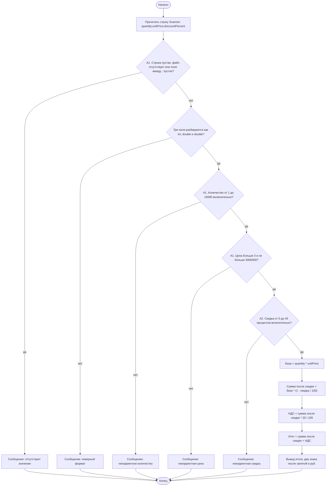

# Activity-диаграмма

A1 — это `isValidQuantity`, `isValidUnitPrice` и разбор пустой строки в `evaluateLine`. A2 — это `isValidDiscount`: скидка 0–45%. После ветки «да» код идёт в `calculateTotal`: база, скидка, затем НДС. Повтор той же строки считается отдельным заказом и проходит тот же путь.
